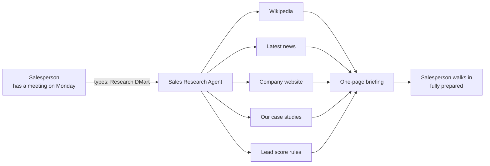
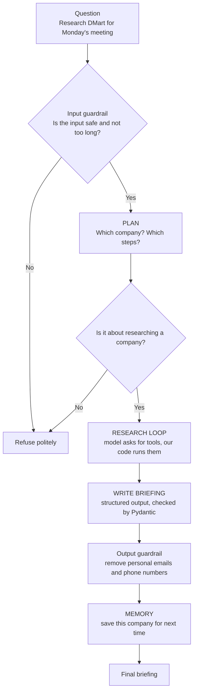
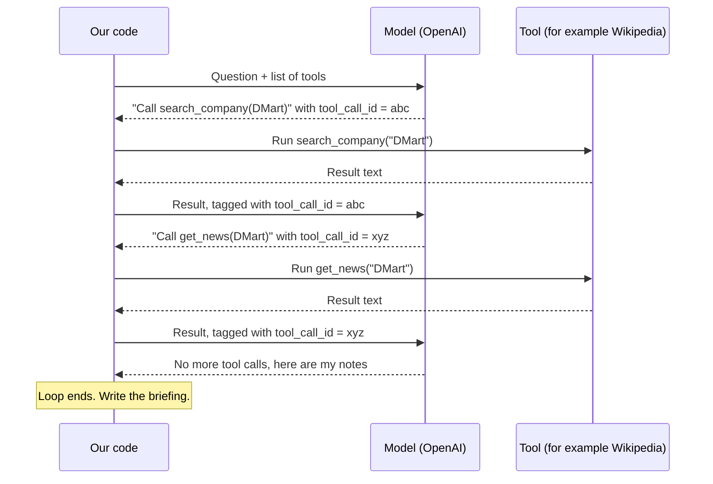
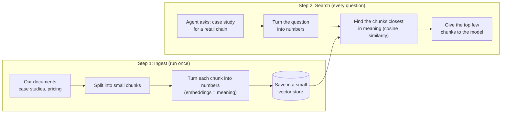
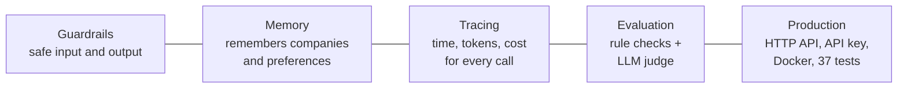

# Sales Research Agent

**A research assistant that prepares a salesperson before a client meeting.**

Type a company name. The agent researches it and gives back a one-page sales meeting briefing: company summary, latest news, lead score, sales opportunities, talking points and matching case studies.

It is built from scratch with the OpenAI SDK. There is no LangChain, LangGraph or CrewAI, so every part of the agent is plain Python you can read.

---

## 1. The story: why does this exist?

**LedgerLeaf Technologies** is a software company that sells to other businesses. It sells invoice automation software, which reads supplier bills, checks them against GST records and makes payments faster. (LedgerLeaf is made up for this demo.)

LedgerLeaf's salespeople meet big companies to sell this software. Say a salesperson has a meeting with **a large retail chain on Monday**. Before the meeting, they need to know:

| Question | Why it matters |
|---|---|
| What does this company do? | So they don't sound unprepared |
| Is there any recent news? | "They opened 50 new stores" means more supplier bills and more need for our software |
| Is this a good customer for us? | Right industry and size? Worth the effort? |
| Which of our success stories fits? | "We helped a retail chain like yours save ₹2.1 crore" |
| What should I say in the meeting? | A few ready talking points |

Doing this by hand takes 1–2 hours of Google searches, news sites and internal files. **The agent does it in about a minute.**



---

## 2. How it works: the full flow



1. **Input guardrail**: blocks bad or very long input before we spend money on the model.
2. **Plan**: the model picks out the company name and writes a short research plan. If the question is not about a company (for example "write me a poem"), the agent refuses.
3. **Research loop**: the heart of the agent (see next section).
4. **Write briefing**: the model turns its notes into a fixed format. Pydantic checks every field.
5. **Output guardrail**: removes personal email addresses and phone numbers. (Unsafe links, such as links into our own network, are already blocked when the website tool runs.)
6. **Memory**: remembers the company, so the next run can build on it.

---

## 3. The agent loop: the most important idea

**An agent is a loop where the model decides and our code does the work.**



| Question | Simple answer |
|---|---|
| Who runs the tool? | **Our code.** The model only asks; it never runs anything itself. |
| How does the result reach the model? | We add it to the chat as a `role: "tool"` message. |
| Why `tool_call_id`? | The model can ask for many tools at once. The id tells it which result belongs to which request. |
| How does the loop know it is done? | When the model replies with **no** tool calls. |
| How do we stop an endless loop? | A `MAX_STEPS` limit. We also block the exact same tool call twice. |

The loop in plain Python (from `agent.py`):

```python
while state.steps < max_steps:          # safety limit
    reply = llm.chat(messages, tools=tool_schemas)
    messages.append(reply.as_message())
    if not reply.tool_calls:            # no tool request = done
        return reply.content
    for call in reply.tool_calls:
        content = run_tool(call)        # OUR code runs the tool
        messages.append({"role": "tool", "tool_call_id": call.id, "content": content})
```

---

## 4. The tools

| Tool | What it gives | Source | Needs a key? |
|---|---|---|---|
| `search_company` | What the company does | Wikipedia | No |
| `get_news` | Latest news | Google News RSS (India edition) | No |
| `fetch_website` | What the company says about itself | The company's own website | No |
| `search_internal_docs` | Our matching case studies and products | `data/docs/` (RAG) | OpenAI (embeddings) |
| `score_lead` | Hot / Warm / Cold score from 0 to 100 | Rules in `data/icp.json` | No |

---

## 5. RAG: searching our own documents

RAG means "find the right pieces of our own documents and give only those to the model". This way the model answers from our real data and does not make things up.



- **Chunks** start with their heading and overlap a little, so no idea is cut in half.
- **Cosine similarity**: 1.0 means the same meaning, 0 means unrelated.

---

## 6. What the briefing looks like

| Section | Example |
|---|---|
| Summary | What the company does, in 2–4 sentences |
| Recent news | Short news lines with dates |
| Lead score | 82 / 100, **Hot**, with reasons |
| Opportunities | "Many suppliers → InvoiceFlow" |
| Talking points | 3–6 things to say or ask in the meeting |
| Case studies | "Retail chain: approval time cut from 18 days to 4" |
| Risks or unknowns | What we could not confirm |
| Sources | Links and document names used |

---

## 7. What makes it more than a demo



---

## 8. Explaining it in an interview

**30-second version:**

> "I built a Sales Research Agent. A salesperson at an invoice-software company has a meeting with a large retail chain on Monday. They type the company name into my agent. It finds what the company does, its latest news, whether it is a good fit, and a matching case study. The salesperson walks into the meeting fully prepared. I built it in plain Python with the OpenAI SDK and no frameworks, because I wanted to understand how an agent works inside."

**Common follow-up questions:**

| They ask | You say |
|---|---|
| Why no LangChain? | To learn what happens inside. Now I can use any framework and know what it does for me. |
| How do you stop endless loops? | A max-steps limit, and the loop ends when the model stops asking for tools. |
| How do you stop made-up answers? | Tools give real facts, RAG gives our real documents, and the prompt says "never invent facts". |
| How do you know the output is good? | Evals: fixed test questions, rule checks and a second model that grades quality. |
| What would you improve? | Better handling of websites that block bots or need JavaScript, and caching repeated searches. |

**Be honest:** the tests use a fake model. The full run with a real OpenAI key is the next step, so don't quote results you don't have yet.

---

## 9. Setup (one time)

```bash
cd ~/sales-research-agent
uv sync                      # installs everything into .venv
cp .env.example .env         # then put your OPENAI_API_KEY in .env
uv run sales-agent ingest    # builds the search index from data/docs
```

## 10. Use it

```bash
uv run sales-agent research "Research DMart for Monday's meeting"
uv run sales-agent research "Is Delhivery a good lead?" --json
uv run sales-agent prefs add "Keep talking points short"
uv run sales-agent serve     # API at http://127.0.0.1:8080/docs
```

## 11. Check it

```bash
uv run pytest                    # 37 tests, uses a fake model, free, no key needed
uv run python evals/run_evals.py # real model on 5 test questions, scores quality
```

## 12. Where each phase lives

| Phase | What it teaches | File |
|---|---|---|
| 1. Basic loop | The while-loop, tool_calls, tool_call_id | `agent.py` -> `_research` |
| 2. Multiple tools | Tool schemas, checking arguments, running tools | `tools/__init__.py`, `tools/*.py` |
| 3. State | What the agent knows during one run | `state.py` |
| 4. Planning | Decide if and how to research before starting | `planner.py` |
| 5. Memory | Remember companies and preferences between runs | `memory.py` |
| 6. RAG as a tool | Chunk, embed, search our own documents | `rag/*.py`, `tools/internal_docs.py` |
| 7. Guardrails | Block bad input, unsafe links and personal data in output | `guardrails.py`, `briefing.py` |
| 8. Observability | Trace every call: time, tokens, cost | `tracing.py`, `logs/traces/*.jsonl` |
| 9. Evaluation | Rule checks + LLM judge on fixed questions | `evals/` |
| 10. Production | HTTP API, API key, Docker | `api.py`, `Dockerfile` |

Start reading at `agent.py`. Everything else plugs into it.

## 13. Make it yours

- Replace `data/docs/*.md` with your company's real product sheets and case studies, then run `ingest` again.
- Edit `data/icp.json` to set your target industries, company size and buying signals.
- Set `SELLER_NAME` in `.env`.

LedgerLeaf Technologies and its documents are made up, for demo use only.


